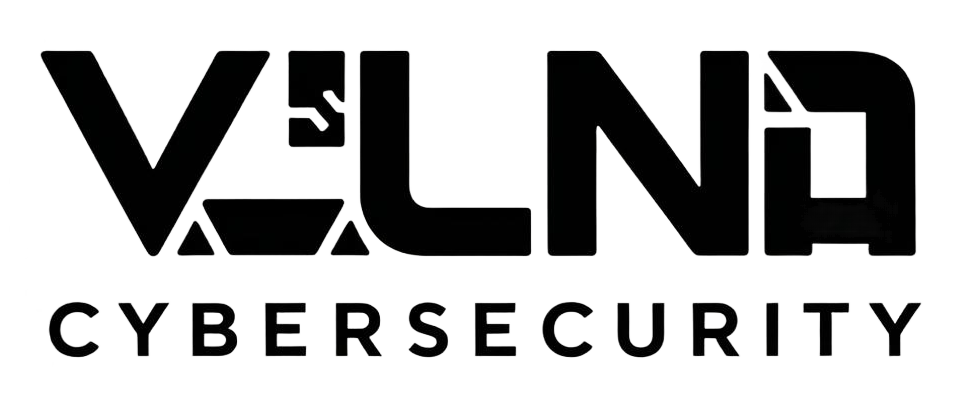
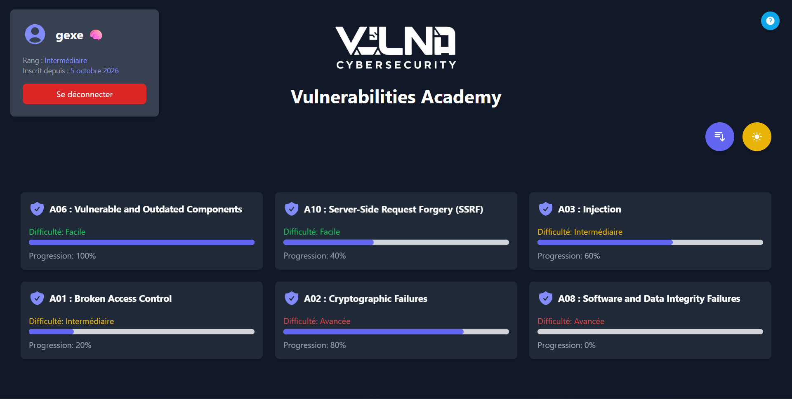
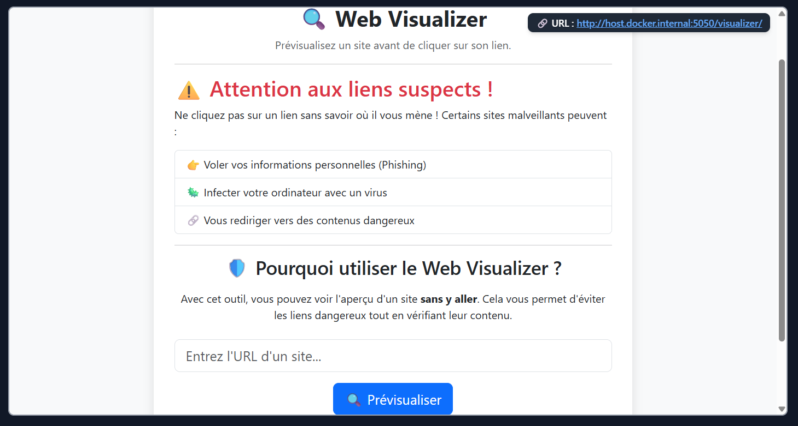
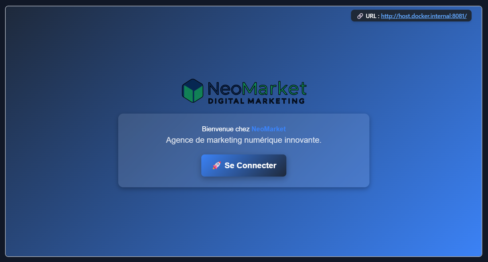
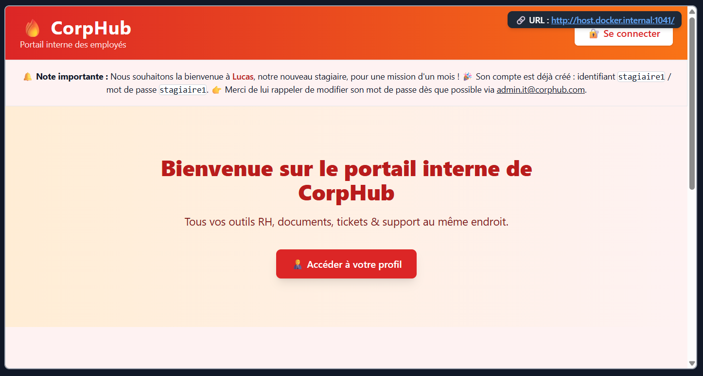
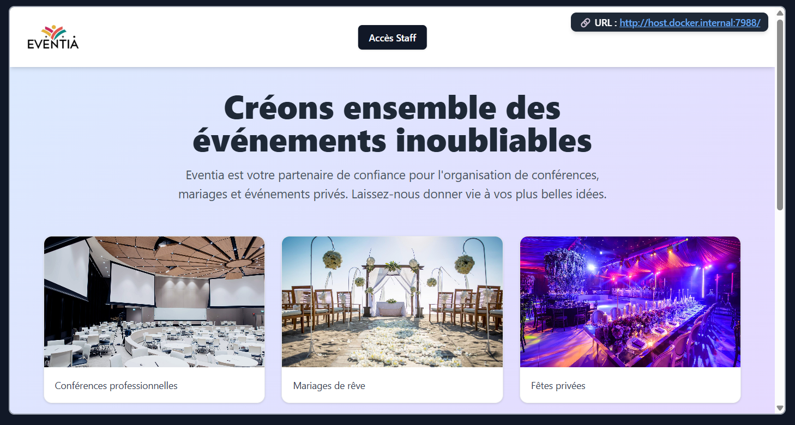
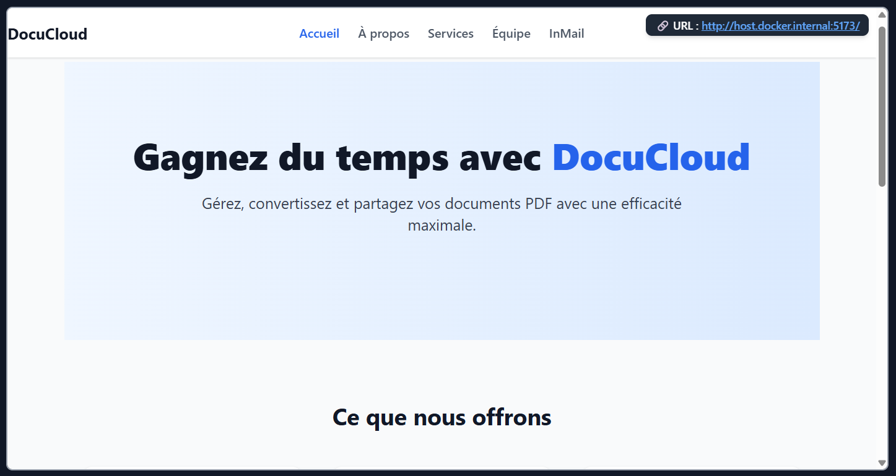
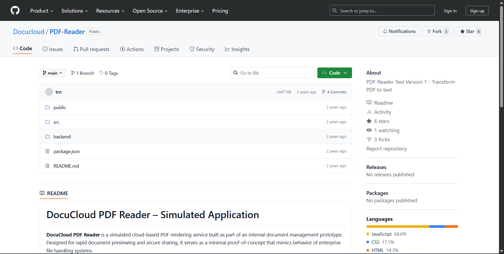
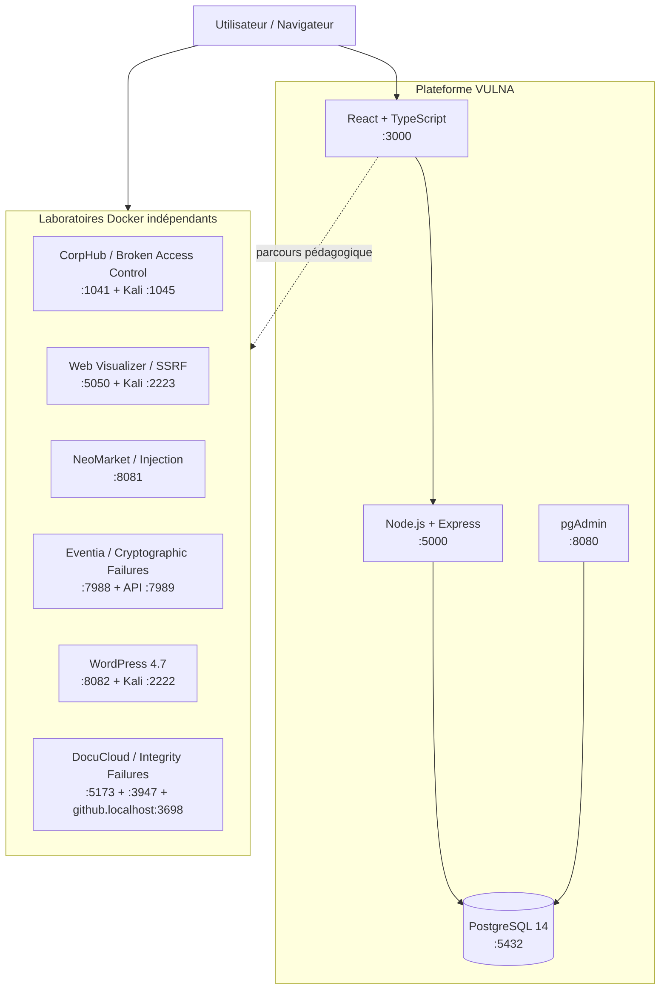

<p align="center">
  <picture>
    <source media="(prefers-color-scheme: dark)" srcset="docs/assets/logo-white.png">
    <source media="(prefers-color-scheme: light)" srcset="docs/assets/logo-black.png">
    
  </picture>
</p>

<h1 align="center">VULNA Cybersecurity</h1>

<p align="center">
  <strong>Vulnerabilities Academy — apprendre la sécurité Web en pratiquant sur des environnements volontairement vulnérables.</strong>
</p>

<p align="center">
  Une plateforme pédagogique conteneurisée consacrée à plusieurs vulnérabilités Web liées à l’<strong>OWASP Top 10:2025</strong>, avec cours guidés, laboratoires réalistes, terminaux Kali, quiz et suivi de progression.
</p>

<p align="center">
  
  
  
  
  
</p>

> [!WARNING]
> **VULNA Cybersecurity contient volontairement des applications, composants, configurations et scénarios vulnérables.** Le projet est destiné à l’apprentissage, aux démonstrations et aux tests en environnement local et isolé. Ne déployez jamais ces services en production et ne les exposez pas directement à Internet.

---

## À propos du projet

**VULNA** — pour *vulnerabilities* — est une plateforme de formation à la cybersécurité Web pensée comme une **Vulnerabilities Academy**. L’objectif n’est pas seulement de décrire une faille, mais de permettre à l’utilisateur de la comprendre dans son contexte, d’observer son impact sur une application réaliste, de manipuler un environnement vulnérable dédié, puis de valider ses acquis avec un quiz.

La plateforme centrale rassemble six laboratoires indépendants. Chaque module combine une partie pédagogique, un scénario applicatif, des étapes d’analyse ou d’exploitation encadrées, un environnement Docker isolé et un système de progression associé au compte utilisateur.

Le projet couvre notamment le contrôle d’accès, l’injection SQL, les défaillances cryptographiques, le SSRF, les composants obsolètes et les problèmes d’intégrité logicielle ou des données.

<p align="center">
  
</p>

---

## Fonctionnalités principales

- **6 laboratoires de cybersécurité** reposant sur des applications volontairement vulnérables et indépendantes.
- **Parcours guidés** présentant le contexte, les objectifs et les différentes étapes d’analyse de chaque vulnérabilité.
- **Dashboard utilisateur** avec progression par module, niveau de difficulté et vue d’ensemble du parcours.
- **Système de rang évolutif** : `Nouveau` → `Débutant` → `Intermédiaire` → `Expert` → `Maître`.
- **Tri des modules** par difficulté ou impact et interface disponible en mode clair/sombre.
- **Tutoriel interactif d’onboarding** pour guider les nouveaux utilisateurs dans l’interface.
- **Authentification et comptes utilisateurs** avec mots de passe hachés et jetons JWT côté API.
- **Progression persistante** enregistrée dans PostgreSQL pour chaque utilisateur et chaque module.
- **Quiz de 5 questions par module**, avec validation immédiate, progression automatique et possibilité de rejouer le quiz terminé.
- **Laboratoires intégrés ou ouverts depuis la plateforme** selon les contraintes techniques du scénario.
- **Terminaux Kali Linux accessibles dans le navigateur** via GoTTY lorsque le module nécessite ou permet l’utilisation d’outils offensifs.
- **Boîte à outils de pentest** dans les environnements Kali : Nmap, Gobuster, Dirb, FFUF, Nikto, ExploitDB, WhatWeb, WPScan et wordlists SecLists.
- **Déploiement Docker Compose** afin de séparer la plateforme centrale, les bases de données et les différents environnements vulnérables.

---

## Modules et correspondance OWASP Top 10:2025

Le projet a été initialement structuré avec certains intitulés et numéros du **Top 10 OWASP 2021**, encore visibles sur quelques cartes de l’interface. Le Top 10 **2025** a fait évoluer ce classement : le tableau ci-dessous donne la correspondance actuelle utilisée pour présenter VULNA sur GitHub.

| Lab VULNA | Scénario pédagogique | Correspondance OWASP 2025 | Difficulté |
|---|---|---|---|
| **Broken Access Control** | CorpHub — contrôle d’autorisation insuffisant, accès à des ressources et documents qui ne devraient pas être accessibles | **[A01:2025 — Broken Access Control](https://top10.owasp.org/2025/A01_2025-Broken_Access_Control/)** | Intermédiaire |
| **Server-Side Request Forgery (SSRF)** | Web Visualizer — requêtes effectuées par le serveur vers des ressources internes et endpoints protégés | **[A01:2025 — Broken Access Control](https://top10.owasp.org/2025/A01_2025-Broken_Access_Control/)** — le SSRF est intégré à cette catégorie en 2025 | Facile |
| **Vulnerable & Outdated Components** | WordPress 4.7 — identification et exploitation pédagogique d’un composant ancien présentant une vulnérabilité connue | **[A03:2025 — Software Supply Chain Failures](https://top10.owasp.org/2025/A03_2025-Software_Supply_Chain_Failures/)** — évolution de l’ancienne catégorie A06:2021 | Facile |
| **Cryptographic Failures** | Eventia — secrets exposés, JWT et manipulation de données chiffrées | **[A04:2025 — Cryptographic Failures](https://top10.owasp.org/2025/A04_2025-Cryptographic_Failures/)** | Avancée |
| **Injection** | NeoMarket — authentification vulnérable à l’injection SQL et exploration structurée des données | **[A05:2025 — Injection](https://top10.owasp.org/2025/A05_2025-Injection/)** | Intermédiaire |
| **Software or Data Integrity Failures** | DocuCloud — modification d’un composant logiciel partagé sans mécanisme suffisant de vérification d’intégrité | **[A08:2025 — Software or Data Integrity Failures](https://top10.owasp.org/2025/A08_2025-Software_or_Data_Integrity_Failures/)** | Avancée |

> **Remarque :** VULNA ne cherche pas à reproduire l’intégralité du Top 10 OWASP 2025. Il propose une sélection de scénarios pratiques associés à plusieurs de ses catégories et faiblesses représentatives.

---

## Aperçu des laboratoires

<table>
  <tr>
    <td align="center"><strong>Vulnerable & Outdated Components</strong><br></td>
    <td align="center"><strong>Server-Side Request Forgery</strong><br></td>
  </tr>
  <tr>
    <td align="center"><strong>Injection</strong><br></td>
    <td align="center"><strong>Broken Access Control</strong><br></td>
  </tr>
  <tr>
    <td align="center"><strong>Cryptographic Failures</strong><br></td>
    <td align="center"><strong>Software or Data Integrity Failures</strong><br></td>
  </tr>
</table>

Le scénario **Software or Data Integrity Failures** pousse l’immersion un peu plus loin avec un **dépôt GitHub entièrement simulé en local**, intégré au parcours DocuCloud. L’utilisateur peut ainsi manipuler une interface familière dans un environnement de laboratoire totalement isolé.

<p align="center">
  
</p>

---

## Parcours utilisateur

1. **Créer un compte ou se connecter** à la plateforme VULNA.
2. **Découvrir le dashboard** et les six modules disponibles.
3. **Choisir un module** selon sa difficulté ou sa position dans le parcours.
4. **Lire le contexte et les étapes pédagogiques** proposées par le module.
5. **Interagir avec le laboratoire vulnérable** depuis l’interface ou dans un nouvel onglet.
6. **Utiliser le terminal Kali** pour les modules qui nécessitent des outils de reconnaissance ou d’analyse.
7. **Répondre au quiz** pour valider la compréhension du scénario.
8. **Faire progresser son profil** et débloquer les rangs associés à la progression globale.

---

## Architecture



### Séparation des responsabilités

| Composant | Rôle |
|---|---|
| `frontend/` | Interface principale VULNA : authentification, dashboard, tutoriel, pages des modules et quiz |
| `backend/` | API principale : comptes, authentification, utilisateurs et progression |
| PostgreSQL | Persistance des comptes et de la progression des modules |
| `bac_site/` | Lab Broken Access Control / CorpHub |
| `ssrf_site/` | Lab SSRF / Web Visualizer + terminal Kali |
| `injection_site/` | Lab Injection SQL / NeoMarket |
| `crypto_site/` | Lab Cryptographic Failures / Eventia |
| `software_site/` | Lab Software or Data Integrity Failures / DocuCloud + dépôt GitHub simulé |
| `vulnerable_site/` | Lab composant obsolète / WordPress 4.7 + terminal Kali |

---

## Stack technique

| Couche | Technologies principales |
|---|---|
| **Frontend VULNA** | React 18, TypeScript, React Router, Tailwind CSS, Framer Motion, Heroicons, React Joyride |
| **API VULNA** | Node.js, Express, JWT, bcryptjs, `pg` |
| **Base principale** | PostgreSQL 14, pgAdmin |
| **Broken Access Control** | Node.js 20, Express, EJS, PostgreSQL 15, Kali Linux, GoTTY |
| **Injection** | Node.js 14, Express, PostgreSQL |
| **Cryptographic Failures** | React 19, Vite, TypeScript, Node.js 18, Express, Prisma, SQLite, JWT |
| **SSRF** | Python 3.9, Flask, Requests, Kali Linux, GoTTY |
| **Vulnerable & Outdated Components** | WordPress 4.7, Apache/PHP, MySQL 5.7, Kali Linux, GoTTY |
| **Software/Data Integrity** | React 19, Vite, Node.js 18, Express, Nginx, Traefik, volume Docker partagé |
| **Infrastructure** | Docker, Docker Compose |

---

## Structure du dépôt

```text
VULNA-Cybersecurity/
├── frontend/                 # Interface principale React / TypeScript
├── backend/                  # API principale Node.js / Express
├── bac_site/                 # Broken Access Control — CorpHub
│   └── kali/                 # Terminal Kali associé
├── crypto_site/              # Cryptographic Failures — Eventia
│   ├── frontend/
│   └── backend/
├── injection_site/           # Injection SQL — NeoMarket
├── software_site/            # Software/Data Integrity — DocuCloud
│   ├── frontend/
│   ├── backend/
│   └── github/               # Dépôt GitHub simulé + éditeur de code
├── ssrf_site/                # SSRF — Web Visualizer
│   └── kali/                 # Terminal Kali associé
├── vulnerable_site/          # WordPress 4.7 volontairement vulnérable
│   ├── db/
│   ├── kali/
│   └── wordpress/
├── docs/
│   ├── assets/               # Assets utilisés par le README
│   └── screenshots/          # Captures de la plateforme et des labs
├── docker-compose.yml        # Plateforme VULNA principale
└── README.md
```

---

## Prérequis

Le projet est conçu pour être exécuté avec Docker. Il n’est pas nécessaire d’installer localement toutes les versions de Node.js, Python, PostgreSQL, MySQL, PHP ou Kali utilisées par les labs.

Vous aurez besoin de :

- **Git** pour récupérer le dépôt ;
- **Docker Engine** ou **Docker Desktop** ;
- **Docker Compose v2** (`docker compose`) ;
- un navigateur Web récent ;
- suffisamment d’espace disque pour les images Docker, notamment les environnements Kali et les dépendances des différents labs.

Vérification rapide :

```bash
docker --version
docker compose version
git --version
```

> Le premier build peut être sensiblement plus long que les suivants : plusieurs images téléchargent et installent des dépendances, des outils Kali ainsi que des wordlists SecLists. Les builds suivants bénéficient normalement du cache Docker.

---

## Installation

```bash
git clone https://github.com/ge-xe/VULNA-Cybersecurity.git
cd VULNA-Cybersecurity
```

### Préparer les fichiers d’environnement des labs

Deux labs utilisent un fichier `.env` local. Le dépôt fournit des modèles `.env.example` contenant uniquement des valeurs de démonstration nécessaires aux scénarios.

Sous **PowerShell / Windows** :

```powershell
Copy-Item .\bac_site\.env.example .\bac_site\.env
Copy-Item .\crypto_site\backend\.env.example .\crypto_site\backend\.env
```

Sous **Linux / macOS** :

```bash
cp bac_site/.env.example bac_site/.env
cp crypto_site/backend/.env.example crypto_site/backend/.env
```

> Les valeurs présentes dans ces exemples sont volontairement locales et pédagogiques. Elles ne doivent jamais être réutilisées pour un service réel ou exposé sur Internet.

### 1. Démarrer la plateforme principale

Depuis la racine du projet :

```bash
docker compose up --build -d
```

Une fois les conteneurs démarrés :

- **VULNA Cybersecurity** : http://localhost:3000
- **API principale** : http://localhost:5000
- **pgAdmin** : http://localhost:8080
- **PostgreSQL** : `localhost:5432`

Vous pouvez vérifier l’état des conteneurs avec :

```bash
docker compose ps
```

Et suivre les logs avec :

```bash
docker compose logs -f
```

### 2. Démarrer le laboratoire souhaité

Les labs sont volontairement séparés de la stack principale. Démarrez uniquement le ou les modules dont vous avez besoin.

#### Broken Access Control — CorpHub

```bash
cd bac_site
docker compose up --build -d
```

Accès :

- application : http://localhost:1041
- terminal Kali : http://localhost:1045
- PostgreSQL du lab : `localhost:1043`

#### Server-Side Request Forgery — Web Visualizer

```bash
cd ssrf_site
docker compose up --build -d
```

Accès :

- Web Visualizer : http://localhost:5050/visualizer
- terminal Kali : http://localhost:2223

#### Injection — NeoMarket

```bash
cd injection_site
docker compose up --build -d
```

Accès :

- application : http://localhost:8081
- PostgreSQL du lab : `localhost:5433`

#### Cryptographic Failures — Eventia

```bash
cd crypto_site
docker compose up --build -d
```

Accès :

- frontend : http://localhost:7988
- backend : http://localhost:7989

#### Vulnerable & Outdated Components — WordPress 4.7

```bash
cd vulnerable_site
docker compose up --build -d
```

Accès :

- WordPress vulnérable : http://localhost:8082
- terminal Kali : http://localhost:2222

#### Software or Data Integrity Failures — DocuCloud

```bash
cd software_site
docker compose up --build -d
```

Accès :

- DocuCloud : http://localhost:5173
- backend DocuCloud : http://localhost:3947
- dépôt GitHub simulé : http://github.localhost:3698
- backend du dépôt simulé : http://localhost:1414
- dashboard Traefik : http://localhost:3699

> Le lab DocuCloud utilise le sous-domaine local `github.localhost`. Sur la majorité des environnements modernes, les domaines `*.localhost` sont résolus vers la machine locale. Si ce n’est pas le cas sur votre système, ajoutez une résolution locale de `github.localhost` vers `127.0.0.1`.

---

## Tableau des ports

| Service | Port hôte | Description |
|---|---:|---|
| VULNA frontend | `3000` | Interface principale |
| VULNA API | `5000` | API utilisateurs / progression |
| PostgreSQL principal | `5432` | Base VULNA |
| pgAdmin | `8080` | Administration PostgreSQL |
| CorpHub | `1041` | Lab Broken Access Control |
| CorpHub PostgreSQL | `1043` | Base du lab BAC |
| CorpHub Kali | `1045` | Terminal Web GoTTY |
| NeoMarket | `8081` | Lab Injection |
| NeoMarket PostgreSQL | `5433` | Base du lab Injection |
| Eventia frontend | `7988` | Lab Cryptographic Failures |
| Eventia backend | `7989` | API du lab Crypto |
| SSRF Web Visualizer | `5050` | Lab SSRF |
| SSRF Kali | `2223` | Terminal Web GoTTY |
| WordPress 4.7 | `8082` | Lab Vulnerable/Outdated |
| WordPress Kali | `2222` | Terminal Web GoTTY |
| DocuCloud frontend | `5173` | Lab Integrity |
| DocuCloud backend | `3947` | Backend dynamique |
| GitHub simulé | `3698` | Frontend via Traefik |
| GitHub simulé backend | `1414` | API de sauvegarde du code |
| Traefik dashboard | `3699` | Dashboard du reverse proxy |

---

## Utilisation des terminaux Kali

Plusieurs labs embarquent un environnement Kali Linux exposé dans le navigateur grâce à **GoTTY**. Ces terminaux évitent d’installer une distribution de pentest séparée et fournissent directement plusieurs outils utiles aux exercices.

Les images Kali du projet installent notamment :

```text
nmap
ffuf
gobuster
dirb
nikto
exploitdb
whatweb
wpscan
SecLists wordlists
```

L’utilisation du terminal dépend du module : elle est **requise** pour certains scénarios, **optionnelle** pour d’autres et **inutile** lorsque l’ensemble de l’exercice peut être réalisé depuis le navigateur.

---

## Progression et quiz

Chaque module possède un quiz de cinq questions. Lorsqu’une réponse est validée, la progression du module est mise à jour via l’API centrale puis stockée dans PostgreSQL.

La plateforme agrège ensuite cette progression sur le dashboard afin de faire évoluer le rang du profil :

```text
Nouveau → Débutant → Intermédiaire → Expert → Maître
```

Une fois un quiz terminé, il peut être rejoué sans perdre la progression déjà enregistrée.

---

## Arrêter ou réinitialiser les environnements

Dans le dossier contenant le `docker-compose.yml` concerné :

```bash
# Arrêter les conteneurs
docker compose down

# Arrêter et supprimer également les volumes du compose
docker compose down -v
```

Pour réinitialiser complètement la base de progression de la plateforme principale, exécutez `docker compose down -v` **à la racine du projet**, puis reconstruisez la stack.

> Attention : la suppression des volumes efface les données persistantes associées au compose concerné.

---

## Dépannage rapide

### Un port est déjà utilisé

Identifiez le service qui utilise le port concerné ou modifiez le mapping dans le `docker-compose.yml` du lab correspondant.

### Docker affiche `the attribute version is obsolete`

Les fichiers Compose historiques du projet utilisent encore parfois la clé `version`. Docker Compose v2 l’ignore et peut afficher un avertissement. Celui-ci n’empêche pas à lui seul le lancement des services.

### Un build Kali est long

C’est attendu lors du premier lancement : l’image installe de nombreux outils et télécharge plusieurs wordlists. Relancer le build sans `--no-cache` permet généralement de profiter des couches déjà construites.

### Un lab ne s’affiche pas dans la page VULNA

Vérifiez d’abord que son propre `docker compose up` a bien été exécuté, puis contrôlez son port dans le tableau ci-dessus avec `docker compose ps` et `docker compose logs -f`.

---

## Sécurité et usage responsable

Ce dépôt est un **laboratoire pédagogique volontairement vulnérable**. Certaines applications contiennent intentionnellement des contrôles d’accès insuffisants, des requêtes SQL non sécurisées, des secrets de démonstration, des composants obsolètes ou des mécanismes permettant d’exécuter des scénarios d’exploitation.

Utilisez VULNA uniquement :

- sur une machine personnelle, une VM ou un environnement de laboratoire que vous contrôlez ;
- sur des systèmes pour lesquels vous disposez d’une autorisation explicite ;
- à des fins de formation, de démonstration ou de recherche encadrée.

**Ne publiez pas directement les ports des labs sur Internet et ne réutilisez jamais les secrets, mots de passe ou configurations de démonstration dans un environnement réel.**

---

## Références

- [OWASP Top 10:2025](https://top10.owasp.org/2025/)
- [OWASP — A01:2025 Broken Access Control](https://top10.owasp.org/2025/A01_2025-Broken_Access_Control/)
- [OWASP — A03:2025 Software Supply Chain Failures](https://top10.owasp.org/2025/A03_2025-Software_Supply_Chain_Failures/)
- [OWASP — A04:2025 Cryptographic Failures](https://top10.owasp.org/2025/A04_2025-Cryptographic_Failures/)
- [OWASP — A05:2025 Injection](https://top10.owasp.org/2025/A05_2025-Injection/)
- [OWASP — A08:2025 Software or Data Integrity Failures](https://top10.owasp.org/2025/A08_2025-Software_or_Data_Integrity_Failures/)
- [Kali Linux](https://www.kali.org/)
- [SecLists](https://github.com/danielmiessler/SecLists)
- [Docker](https://www.docker.com/)

---

<p align="center">
  <strong>VULNA Cybersecurity</strong><br>
  Learn. Practice. Understand vulnerabilities.
</p>

<p align="center">
  <sub>Projet pédagogique de cybersécurité — environnements volontairement vulnérables, à utiliser uniquement dans un cadre local et autorisé.</sub>
</p>
